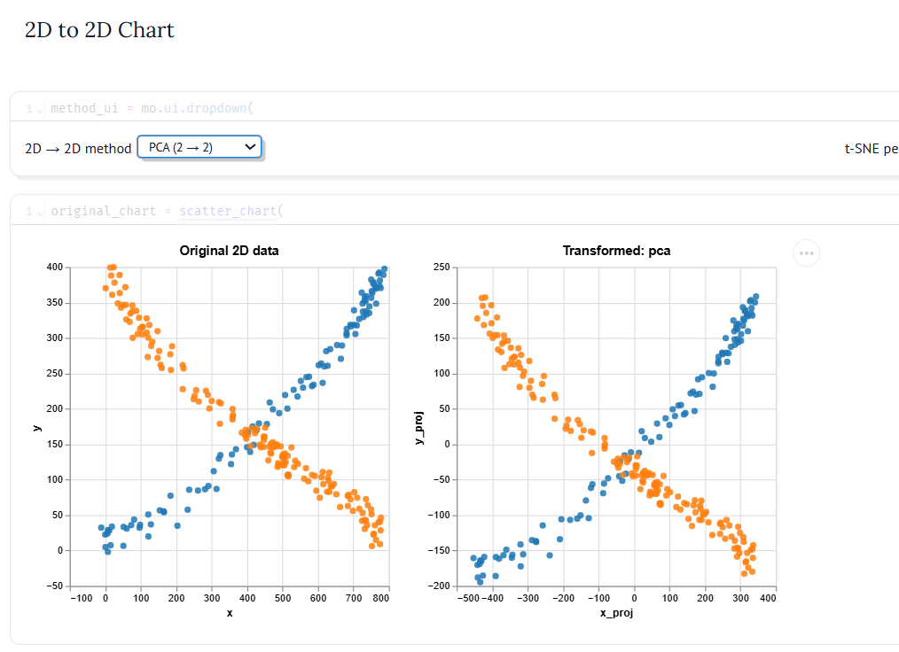
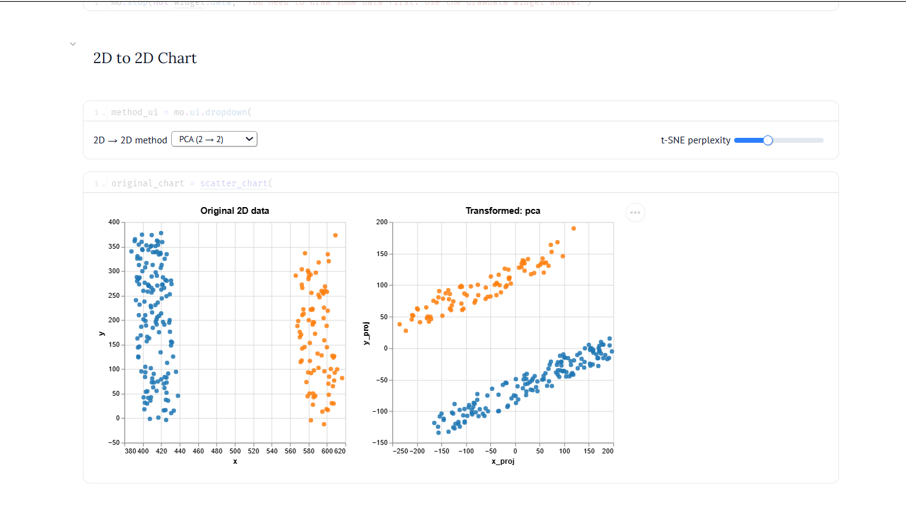
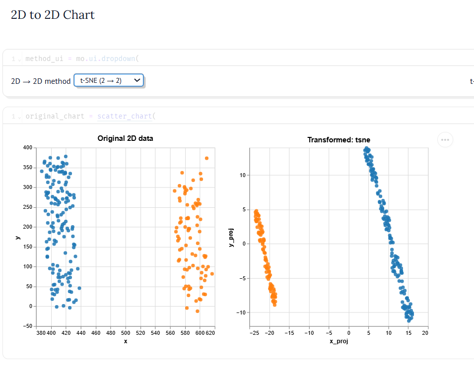
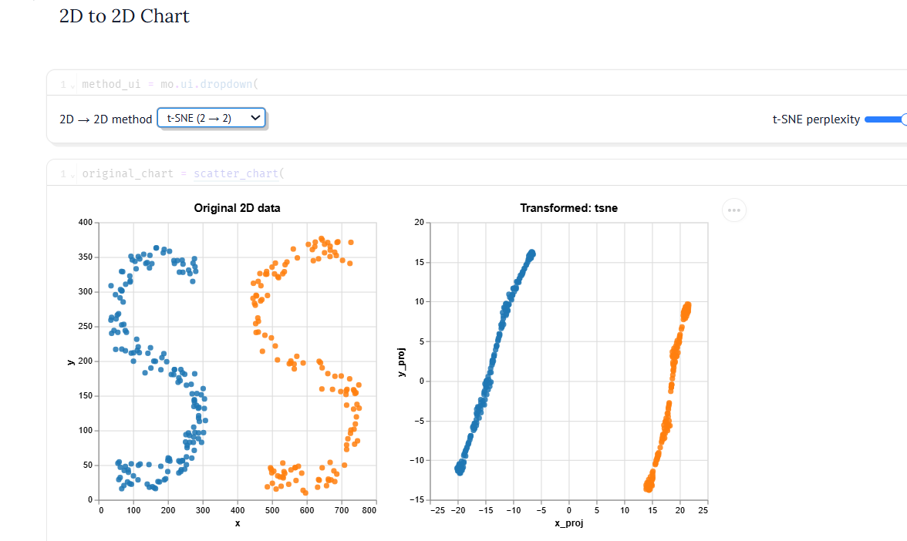
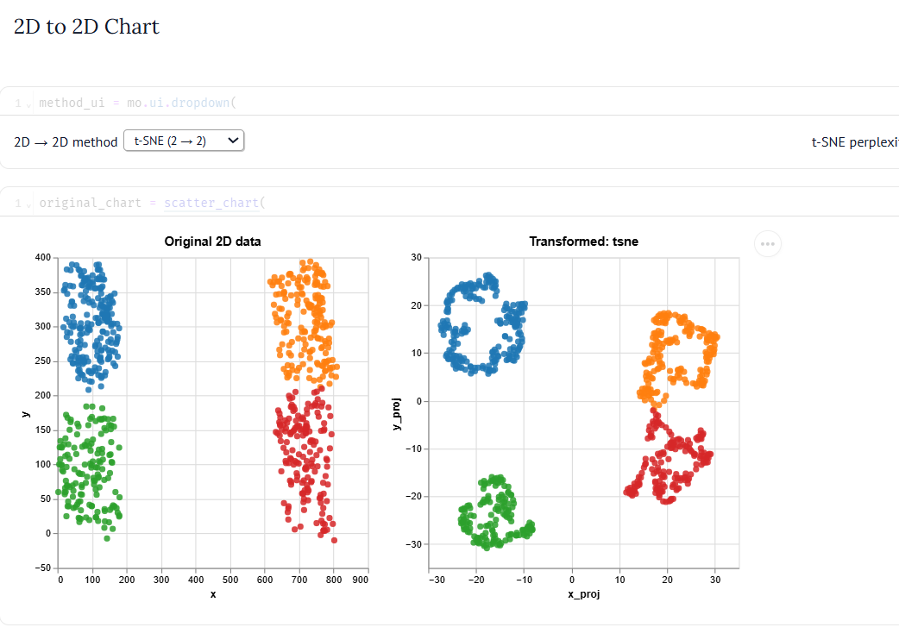
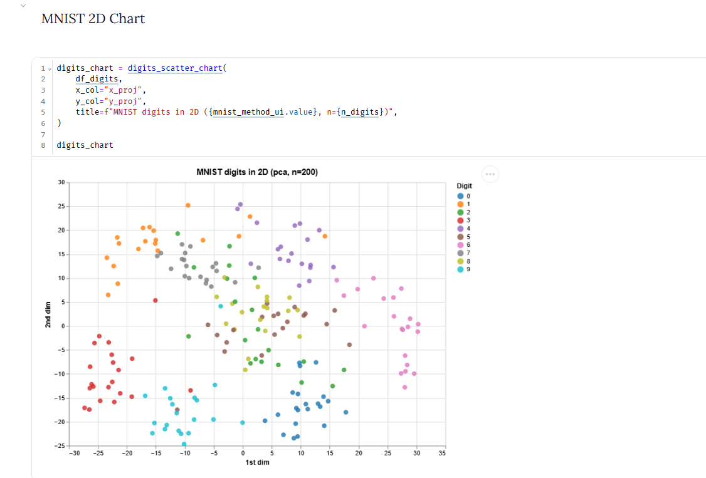
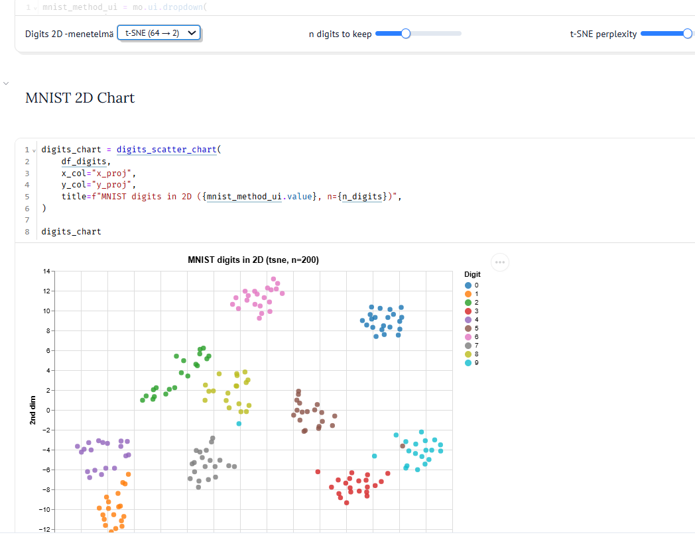
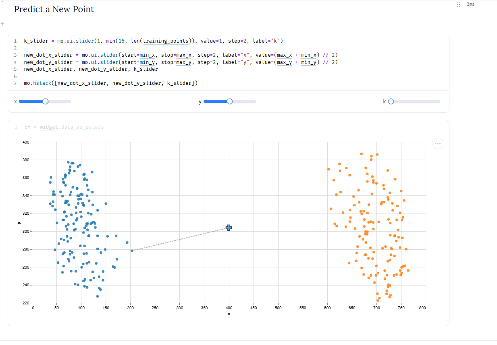
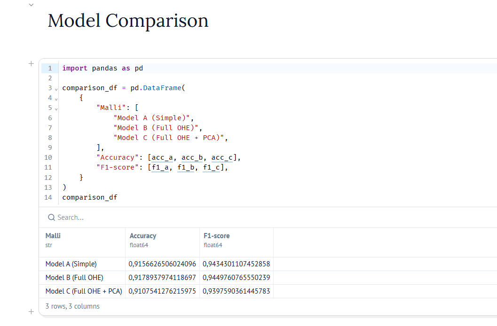

# Viikko 41: Dimensiovähennys (PCA ja t-SNE)

Tällä viikolla kokeilin dimensiovähennystä kahdella eri menetelmällä: PCA:lla ja t-SNE:llä. Testasin niitä ensin Drawdata-työkalulla (2D-pisteet) ja sen jälkeen MNIST-numerodatalla.

## 1. Menetelmien perusidea

- **PCA:** Lineaarinen menetelmä. Se etsii suunnat, joissa data vaihtelee eniten, ja kääntää akselit niiden mukaan. Se säilyttää datan yleisen muodon, mutta ei toimi hyvin, jos data on mutkikasta tai käyrää.
- **t-SNE:** Epälineaarinen menetelmä. Se katsoo vain sitä, mitkä pisteet ovat lähellä toisiaan (naapureita). Se löytää erilliset ryhmät ja klusterit tosi hyvin.

## 2. Kokeet Drawdata-pisteillä

Piirsin eri muotoja ja katsoin, miten menetelmät muuttavat niitä:

### Risti (X-muoto)
PCA keskittää pisteet ja kääntää ne, mutta ristin keskellä eri luokat menevät päällekkäin. PCA on suora menetelmä, joten se ei osaa erottaa leikkaavia viivoja.

### Rinnakkaiset viivat (II-muoto)
PCA kääntää viivat ja säilyttää niiden suoruuden ja välin. t-SNE taas tekee kummastakin viivasta oman tiiviin nauhan. Molemmat erottavat luokat hyvin.

### S-muoto (mutkitteleva viiva)
Tässä näkyy iso ero: PCA pitää S-muodon ennallaan, mutta t-SNE vetää mutkittelevan nauhan suoraksi, koska se keskittyy vain vierekkäisiin pisteisiin.

### Windows-logo (4 ryhmää)
Kun pisteet ovat selkeästi omissa kulmissaan, molemmat menetelmät toimivat hyvin. t-SNE kerää ryhmät vielä tiiviimmiksi palloiksi.

## 3. MNIST-numerot (kuvadatan tiivistäminen)

MNIST-kuvissa on 64 pikseliä (8x8), ja ne tiivistettiin kahteen ulottuvuuteen:
- **PCA:** Numerot ryhmittyvät vähän, mutta monet numerot menevät sekaisin, koska 2 ulottuvuutta lineaarisesti ei riitä kuville.
- **t-SNE:** Jakaa numerot (0–9) tosi selkeiksi omiksi saarekkeiksi ilman, että malli tiesi numeroita etukäteen.

## 4. k-NN ja mallivertailu (Automaattivaihteet)

### k-NN from Scratch

Toteutin $k$-NN-algoritmin alusta alkaen ilman valmiita koneoppimiskirjastoja. Pisteiden välinen etäisyys laskettiin euklidisella etäisyydellä. Luokitus tehtiin suoraan enemmistöpäätöksellä lähimpien naapureiden joukosta.

---

### Automaattivaihteiden luokittelu ja PCA:n vaikutus

Vertailin tehtävässä kolmea eri $k$-NN-mallivarianttia:
- **Malli A (Simple):** Numeeriset ja yksinkertaiset kategoriaominaisuudet ilman automerkkiä ja -mallia.
- **Malli B (Full OHE):** Kaikki ominaisuudet mukana, myös One-Hot-enkoodatut automerkki ja -malli.
- **Malli C (Full OHE + PCA):** Kaikki ominaisuudet, joiden dimensioita pienennettiin PCA-menetelmällä ennen luokitusta (20 komponenttia).

| Malli | Accuracy | F1-score |
| :--- | :--- | :--- |
| **Model A (Simple)** | 0.9157 | 0.9434 |
| **Model B (Full OHE)** | 0.9179 | 0.9450 |
| **Model C (Full OHE + PCA)** | 0.9108 | 0.9398 |

---

### Onko PCA hopealuoti k-NN:lle?

Ei ole. Vaikka PCA nopeuttaa laskentaa ja tiivistää satoja One-Hot-koodattuja sarakkeita harvempaan tilaan, se samalla hävittää osan tarkasta informaatiosta. Tämän takia mallin tarkkuus ja F1-tulos laskivat hieman verrattuna suoraan One-Hot-koodattuun malliin B. Lisäksi k-NN-mallit eivät yltäneet Random Forestin huipputasoon (~0.96–0.97).