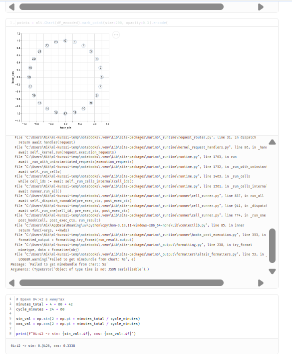
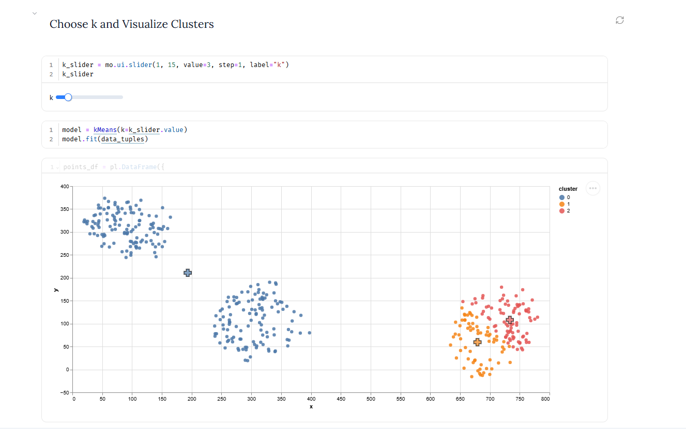
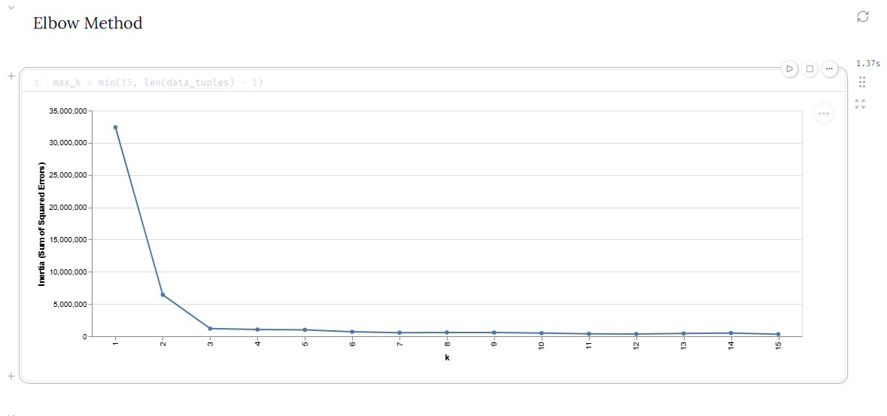
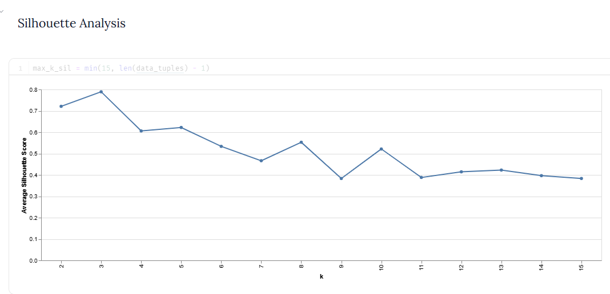
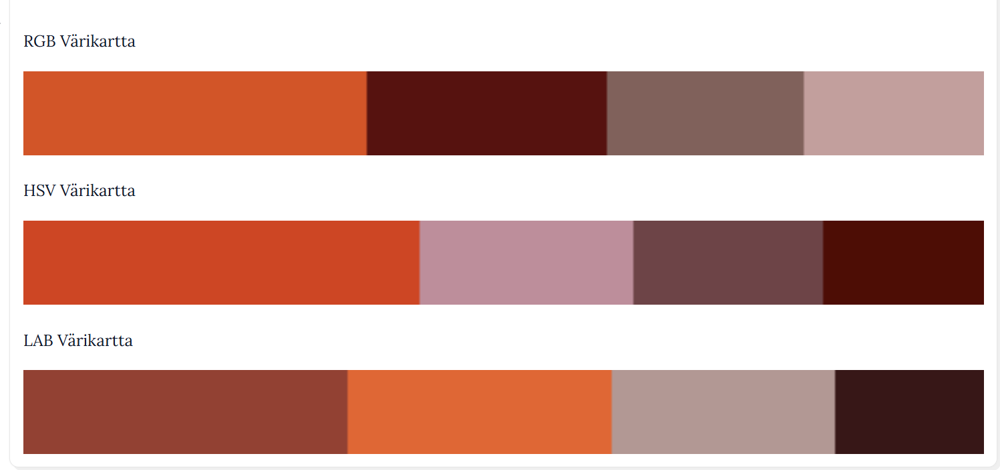

# Viikko 42

## Syklinen enkoodaus (Cyclical Encoding)

Tällä viikolla perehdyin syklisten piirteiden käsittelyyn koneoppimisessa. Esimerkiksi kellonaika, viikonpäivä ja kuukausi toistuvat syklissä.

### Ongelma ja ratkaisu

Tavallisessa numeerisessa muodossa kellonajat 23:00 ja 01:00 ovat kaukana toisistaan (|23 - 1| = 22). Oikeasti eroa on kuitenkin vain kaksi tuntia. Tämä vääristää etäisyyteen perustuvia malleja, kuten k-Means-klusterointia.

Ongelma korjataan siirtämällä aika yksikköympyrälle sin- ja cos-funktioilla:
- `x_sin = sin(2 * pi * x / x_max)`
- `x_cos = cos(2 * pi * x / x_max)`

Tällä tavalla 23:00 ja 00:00 pysyvät lähellä toisiaan myös matemaattisesti.

### Havainnot

- Testasin koodia Marimo-muistiossa Polars- ja NumPy-kirjastoilla 24 tunnille.
- Laajensin koodin myös minuuttitasolle (klo 04:42). Kun syklin pituus on 24 × 60 = 1440 minuuttia, aika 04:42 (282 min) saa ympyrällä arvot sin ≈ 0,94 ja cos ≈ 0,33.

## Tehtävä: k-Means from scratch

Tällä viikolla tutustuin ohjaamattomaan oppimiseen ja k-Means-klusterointiin. Tutkin harjoituksessa k-Means-algoritmin toimintaperiaatetta Marimo-muistiossa, jossa algoritmin toiminta oli toteutettu alusta alkaen (from scratch) ilman Scikit-learnin valmista mallia.

### 1. Datan generointi ja klusterointi

Piirsin aluksi `ScatterWidget`-työkalulla kaksiulotteisen aineiston. Siihen tuli kolme selkeää pisteryhmää. Sen jälkeen ajoin k-Means-algoritmin ja piirsin tuloksen näkyviin.

Kuvasta näkee hyvin, miten algoritmi jakaa pisteet omiin väreihinsä. Se asettaa myös keskipisteet eli sentroidit tarkasti ryhmien keskelle.

### 2. Optimaalisen klusterimäärän (k) arviointi

Koska kyseessä on ohjaamaton oppiminen, aineistossa ei ole valmiita luokkia. Siksi testasin parhaan klusterimäärän löytämiseen kahta eri tapaa:

#### Kyynärpäämenetelmä (Elbow Method)
Laskin neliövirheiden summan (inertia) eri k-arvoilla väliltä 1–15.

Käyrässä näkyy selvä "kyynärpää" kohdassa k = 3. Tämän pisteen jälkeen virhe pienenee enää hyvin hitaasti. Se tarkoittaa, että lisäklusterit eivät enää paranna tulosta juurikaan.

#### Siluettianalyysi (Silhouette Analysis)
Laskin keskimääräisen siluettiarvon, jotta näin kuinka tiiviitä ja erillään ryhmät oikeasti ovat.

Siluettiarvo on korkeimmillaan (noin 0,79) juuri arvolla k = 3. Klusterit ovat siis selvästi erillään toisistaan ja ryhmät pysyvät tiiviinä.

### Yhteenveto

Molemmat tavat – kyynärpäämenetelmä ja siluettianalyysi – antavat saman tuloksen. Luodulle datalle luonnollinen ja järkevin klusterimäärä on selvästi k = 3.

## Tehtävä: Tikkurilan värikartta (511_color_swatch.py)

Tein hedelmäkuvasta (*5 A Day*, Terry Kearney) värikarttoja k-Means-klusteroinnilla eri väriavaruuksissa. Tavoitteena oli löytää kuvalle k = 4 pääväriä. Samalla vertailin, mikä väriavaruus vastaa parhaiten sitä, miten ihmissilmä näkee värit.

### Väriavaruuksien käsittely ja mallit

Opetin tehtävässä kolme erillistä k-Means-mallia:

1. **RGB**: Klusteroin pikselit suoraan kanavien [R, G, B] euklidisella etäisyydellä. Tämä on suoraviivainen tapa, mutta perus-RGB ei huomioi sitä, että ihmissilmä erottaa eri aallonpituuksia ja värejä eri tavalla.
2. **HSV (syklinen sini/kosini-enkoodaus)**: Värisävy eli Hue (arvoalue 0–180) kiertää ympyrän muotoisesti. Muunsin sen trigonometrisiksi koordinaateiksi:
   - `Hue_sin = sin(2 * pi * Hue / 180)`
   - `Hue_cos = cos(2 * pi * Hue / 180)`  
   Tämä poistaa keinotekoisen etäisyyshypyn punaisen sävyn päistä (0° ≈ 360°). Klusteroin datan neljässä ulottuvuudessa: [Hue_sin, Hue_cos, S, V].
3. **CIELAB**: LAB-väriavaruus on kehitetty vastaamaan ihmisen omaa näköaistia (*perceptually uniform*). Pisteiden välinen euklidinen etäisyys avaruudessa vastaa suoraan silmin havaittavaa värieroa.

### Tulokset ja väripaletit

Jokaisen väripalkin leveys kertoo sen, kuinka suuri osuus pikseleistä kuuluu kyseiseen klusteriin:

### Havainnot

- **RGB** ottaa mukaan herkästi tummia ja harmahtavia sävyjä. Silloin hedelmien kirkkaat päävärit jäävät vähän piiloon.
- **HSV** säilyttää puhtaat värisävyt huomattavasti paremmin, koska Hue-kulma koodattiin syklisesti.
- **CIELAB** tuotti omaan silmään kaikkein luonnollisimman ja tasapainoisimman paletin. Se erottelee kuvan tärkeimmät hedelmäsävyt (kuten oranssin ja viininpunaisen) parhaiten.