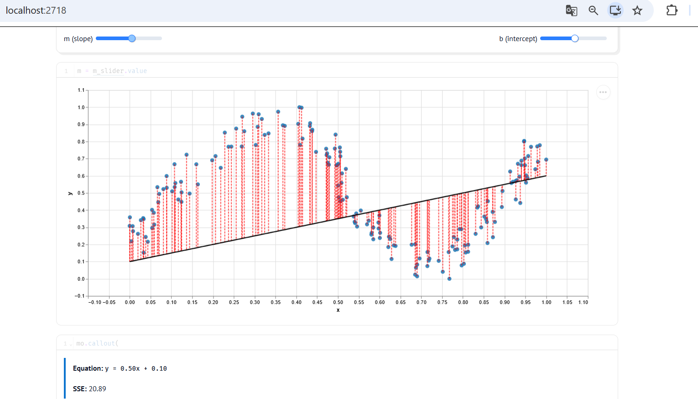
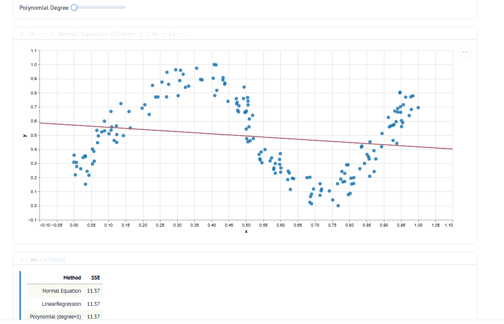
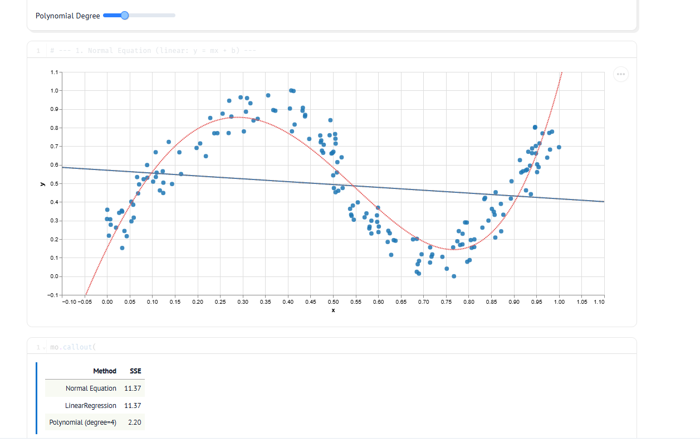
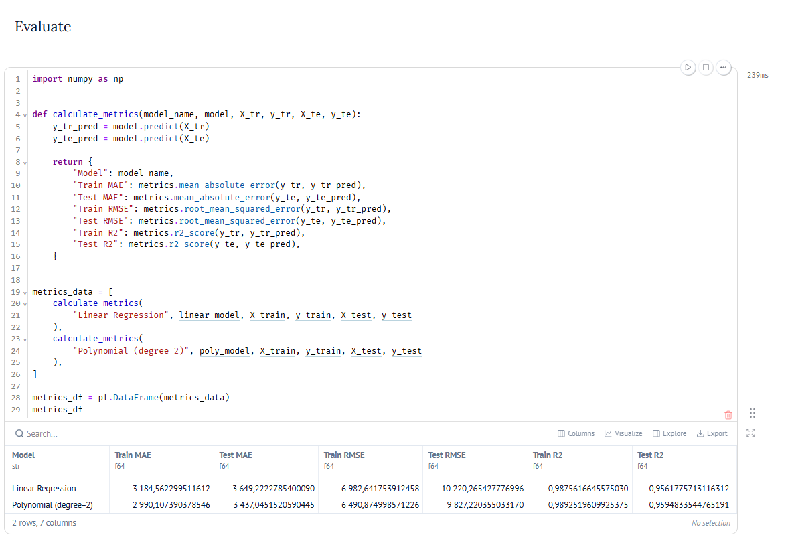
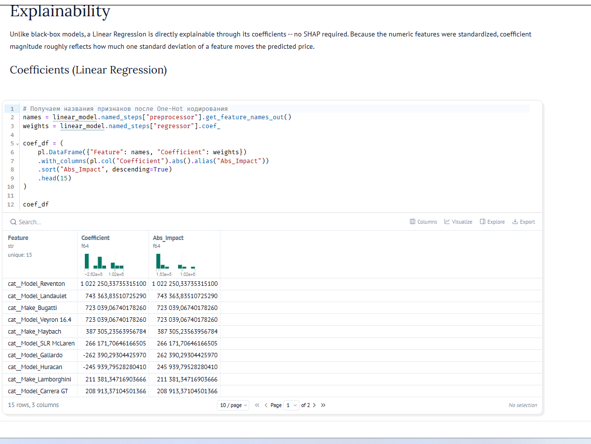

# Viikko 43: Lineaarinen regressio ja normaaliyhtälö

## 1. Johdanto ja viikon tavoitteet

Tällä viikolla tutustuin lineaariseen regressioon. Toisin kuin aiemmin luokittelussa tai klusteroinnissa, regressiossa tavoitteena on ennustaa jatkuvaa numeroarvoa.

Viikon tärkeimmät asiat olivat:
- Ymmärtää suoran sovittaminen datapisteisiin yhtälöllä y = mx + b.
- Katsoa jäännöstermejä (residuaalit) sekä pienimmän neliösumman kriteeriä (SSE, Ordinary Least Squares).
- Kokeilla normaaliyhtälöä w = inv(X^T * X) * X^T * y, jolla parhaat kertoimet saadaan suoraan matriisilaskulla ilman iteratiivista optimointia.
- Pohtia normaaliyhtälön ongelmia: multikollineaarisuus vaikeuttaa matriisin kääntämistä ja iso piirremäärä tekee laskennasta hidasta.
- Testata ali- ja ylisovittumista muuttamalla polynomin astelukua.

---

## 2. Tehtävä: Pienimmän neliösumman menetelmä (Marimo)

Tein tehtävän interaktiivisessa Marimo-muistiossa (`600_least_squares_problem.py`). Tein aluksi `drawdata`-työkalulla aaltomaisen pisteparven, jossa oli selkeää epälineaarisuutta. Sen jälkeen sovitin siihen erilaisia malleja.

### 2.1 Manuaalinen suoran sovittaminen

Ensimmäisessä vaiheessa yritin sovittaa suoraa käsin. Säädin kulmakerrointa m ja vakiotermiä b.

Kuten kuvaajasta näkyy, valitsemillani arvoilla (m = 0.50, b = 0.10) neliösumma (SSE) oli **20.89**. Suora viiva ei mitenkään sovi aaltomaiseen dataan. Residuaalit eli punaiset katkoviivat jäävät vielä todella pitkiksi.

### 2.2 Analyyttinen ratkaisu ja asteen 1 regressio

Seuraavaksi laskin parhaan suoran suoraan normaaliyhtälöllä ja kokeilin myös Scikit-Learnin valmista `LinearRegression`-mallia.

Molemmat tavat antoivat täysin saman tuloksen:
- **Normal Equation SSE:** 11.37
- **LinearRegression SSE:** 11.37
- **Polynomial (degree=1) SSE:** 11.37

Vaikka analyyttinen kaava löytää parhaan mahdollisen suoran ja virhe puolittuu, malli kärsii selvästi **alisovittumisesta (underfitting)**. Suora viiva on liian yksinkertainen tällaiselle kaarevalle datalle.

### 2.3 Polynomiregression sovittaminen (degree = 4)

Korjasin alisovittumisen lisäämällä malliin joustavuutta. Kasvatin polynomin astelukua neljään asti (`degree=4`).

Kun asteen arvoksi laitettiin 4, mallin virhe pieneni huomattavasti:
- **Polynomial (degree=4) SSE:** **2.20**

Neljännen asteen polynomi seuraa datan aaltomaista muotoa tosi siististi. Se ei myöskään tartu liikaa satunnaiseen kohinaan. Jos asteen nostaisi liian korkeaksi (esimerkiksi asteille 8–12), tulisi vastaan **ylisovittuminen (overfitting)**. Silloin käyrä tekisi jyrkkiä mutkia ja yrittäisi osua jokaiseen pisteeseen.

---

## 3. Havainnot ja itsearviointi

- **Analyyttinen vs. iteratiivinen:** Normaaliyhtälö antaa heti tarkan vastauksen pienelle datalle. Huono puoli on kuitenkin matriisin kääntämisen raskaus (aikavaativuus kasvaa jyrkästi piirteiden määrän mukaan) ja se, että liikaa toisistaan riippuvat piirteet estävät matriisin kääntämisen.
- **Residuaalit:** Neliösumma rankaisee isoista heitoista todella paljon enemmän kuin pienistä virheistä. Siksi malli yrittää välttää kaukana olevia pisteitä.
- **Monimutkaisuuden säätö:** Polynomin asteen kasvattaminen laskee aina opetusdatan virhettä. Ilman validointia liian iso aste kuitenkin johtaa ylisovittumiseen ja huonoon ennustekykyyn uudella datalla

## Tehtävä: Auton hintaennustimen suorituskyky

Tässä tehtävässä (`610_car_price.py`) ennustin autojen hintoja (MSRP). Käytin piirteinä sekä numeerisia että kategorisia tietoja.

### Esikäsittely ja mallit

Rakensin esikäsittelyn `Pipeline`- ja `ColumnTransformer`-työkaluilla:

- **Numeeriset piirteet:** Paikkasin puuttuvat arvot mediaanilla ja skaalasin arvot (`StandardScaler`).
- **Kategoriset piirteet:** Käsittelin puuttuvat tiedot ja muutin sarakkeet numeroiksi One-Hot-koodauksella (`OneHotEncoder`).

Koulutin kaksi eri mallia: tavallisen lineaarisen regression (`LinearRegression`) sekä toisen asteen polynomimallin (`degree=2`), jossa toisen asteen termit tehtiin vain numeerisille piirteille.

### Tulokset ja mittarit

Testasin mallien toimintaa testidatalla ja laskin virheet (MAE, RMSE, R²):

- **Lineaarinen malli:** Test MAE ≈ 3 649 $, RMSE ≈ 10 220 $, R² = 0.956
- **Polynomimalli (aste 2):** Test MAE ≈ 3 437 $, RMSE ≈ 9 827 $, R² = 0.959

Polynomiset piirteet paransivat tulosta hieman. Virheet pienenivät ja R² nousi, eikä malli lähtenyt ylisovittumaan. RMSE-luku on molemmilla melko korkea. Se johtuu siitä, että datassa on mukana todella kalliita ääripään autoja, joista neliöllinen virhe rankaisee kovaa.

### Tärkeimmät piirteet (Kertoimet)

Eniten hintaa nostavat harvinaiset luksus- ja urheiluautot (kuten `Reventon`, `Landaulet` ja `Bugatti Veyron`). Näiden mallien kertoimet tuovat perushintaan heti satoja tuhansia tai jopa yli miljoonan dollarin lisän.