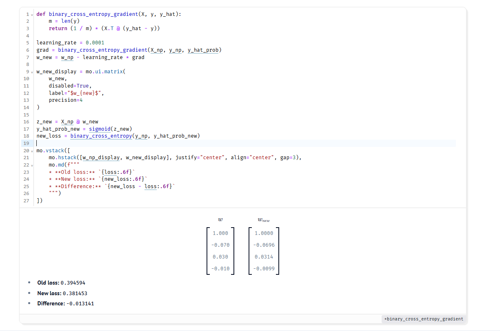
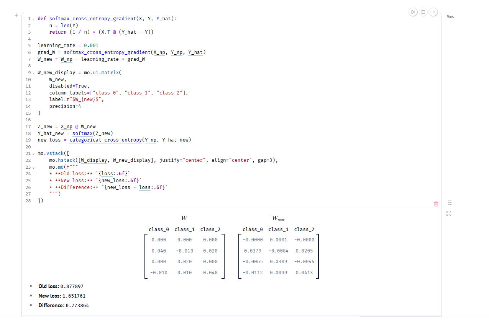
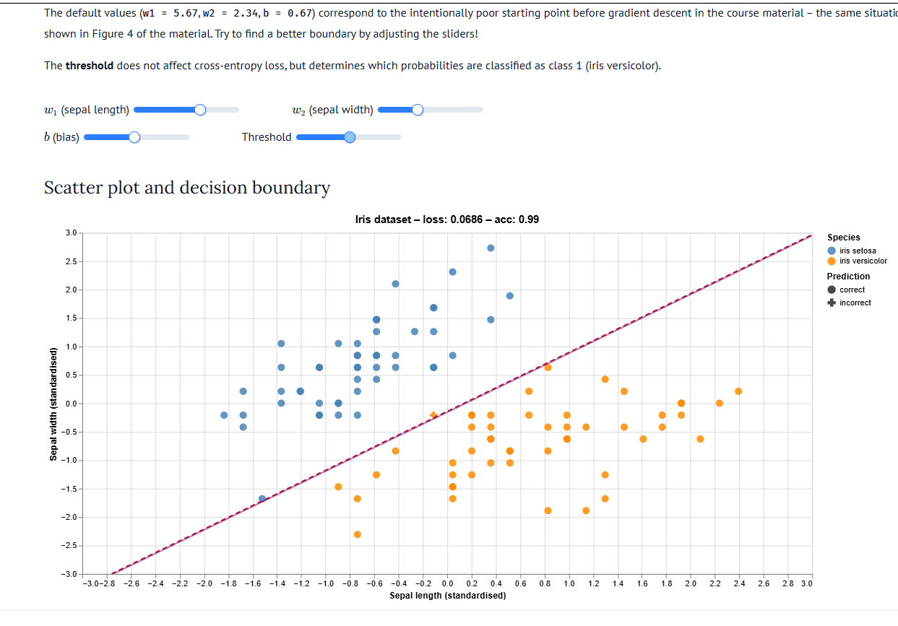
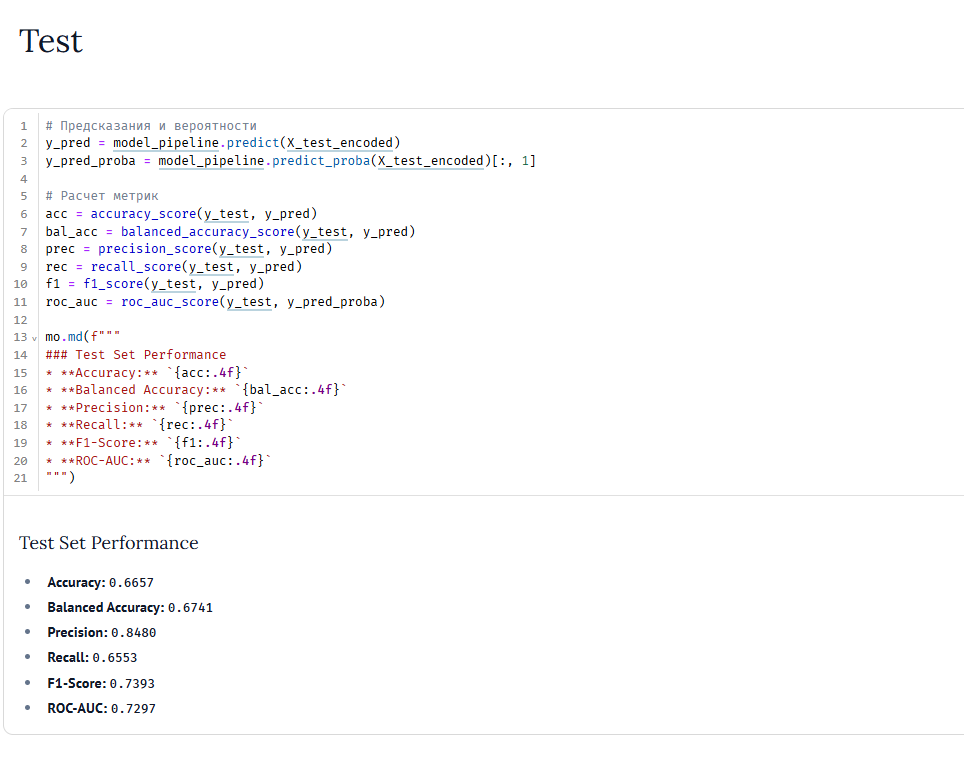
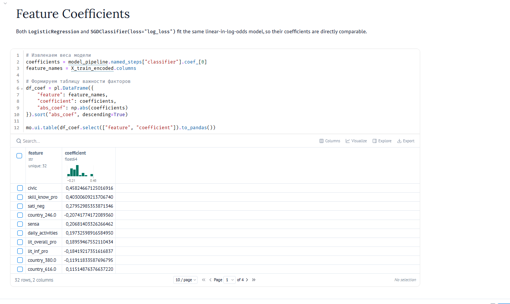

# Viikko 44: Logistinen regressio ja kyberviha

Tällä viikolla perehdyin logistisen regression perusteisiin, gradienttilaskeutumisen toimintaan sekä kybervihan ennustamiseen ySKILLS-aineistosta.

---

## 1. Binäärinen logistinen regressio (710)

Laskin virheen gradientin ja tein yhden painojen päivityksen oppimisnopeudella 0.001. Päivityksen jälkeen mallin virhe (loss) pieneni juuri niin kuin pitikin.

---

## 2. Moniluokkainen logistinen regressio (711)

Kokeilin moniluokkaisessa Softmax-mallissa yhtä päivitysaskelta samalla oppimisnopeudella (0.001):

- **Vanha loss:** 0.8779
- **Uusi loss:** 1.6518

Virhe lähti nousuun laskun sijaan. Tämä johtui siitä, että dataa ei ollut skaalattu etukäteen ja piirteiden arvot olivat isoja (esimerkiksi pituus noin 180). Tällöin askelkoko muodostui liian suureksi, ja optimointi hyppäsi minimin yli (overshooting).

---

## 3. Päätösrajan visualisointi (712)

Testasin Iris-datalla, miten eri painokertoimet muuttavat luokittelun päätösrajaa. Kun säädin kertoimia käsin kohdalleen, löysin rajan, jolla malli erotti luokat toisistaan 99 % tarkkuudella (loss: 0.0686, accuracy: 0.99).

---

## 4. Kybervihan riskin ennustaminen: ySKILLS (714)

Koulutin logistisen regression mallin ennustamaan nuorten kokemaa kybervihaa (`RISK101`). Suurin osa vastaajista (noin 72 %) oli kokenut kybervihaa, joten aineisto oli vahvasti epätasapainossa. Korjasin tämän käyttämällä mallissa luokkapainotusta (`class_weight`).

### Testitulokset:
- **Tarkkuus (Accuracy):** 0.6657
- **Tasapainotettu tarkkuus (Balanced Accuracy):** 0.6741
- **F1-pisteet:** 0.7393
- **ROC-AUC:** 0.7297

### Tärkeimmät riskitekijät:
- **Riskiä lisäävät:** Aktiivinen osallistuminen verkkokeskusteluihin (`civic`: +0.458), laajat digitaaliset taidot (`skill_know_pro`: +0.403) sekä psyykkinen kuormitus (`sati_neg`: +0.280).
- **Riskiä vähentävät:** Hyvä informaatiolukutaito ja kyky arvioida sisältöä kriittisesti (`lit_inf_pro`: -0.184) sekä asuinmaa Suomi (-0.207).

