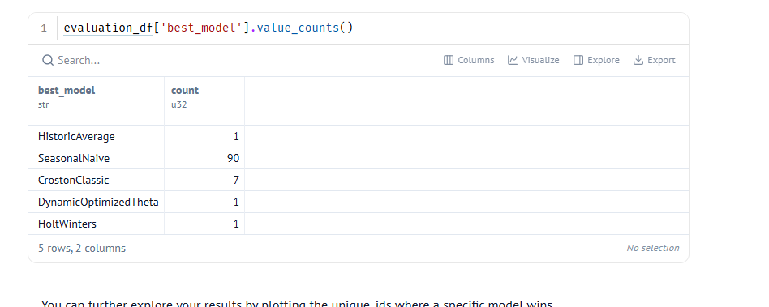
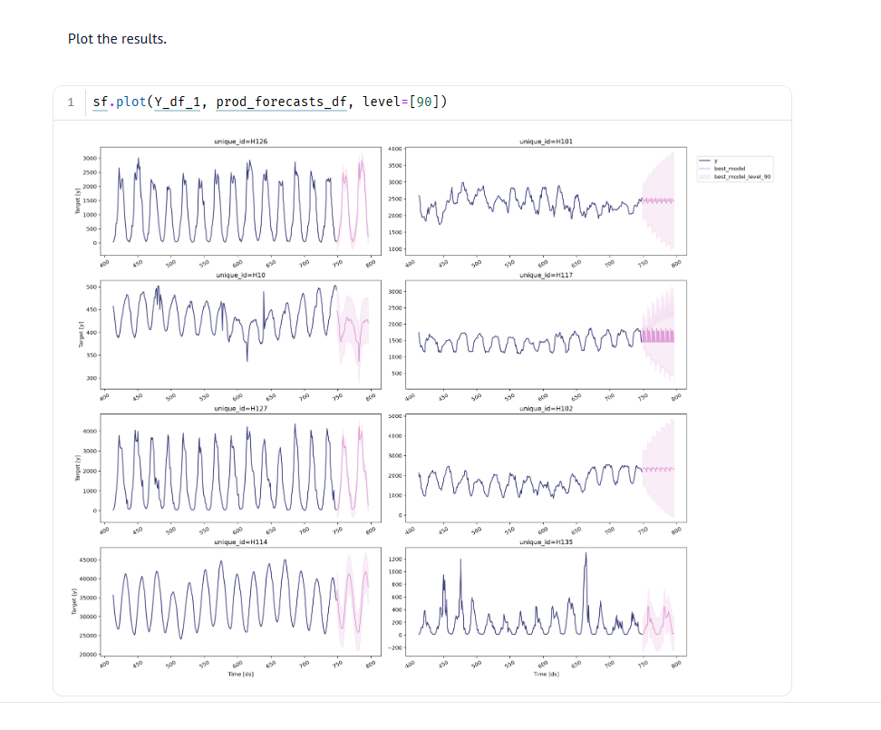
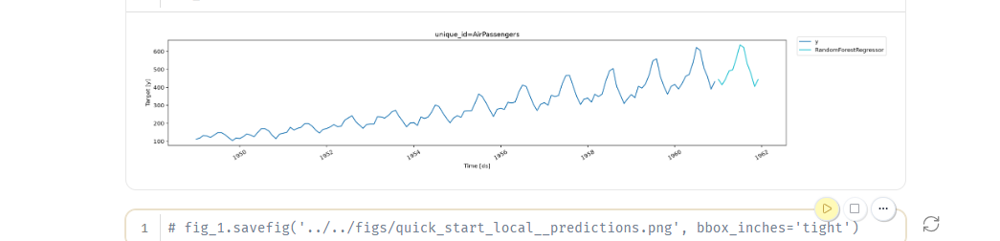

# Viikko 45: Aikasarjojen ennustaminen (Time Series Forecasting)

Tällä viikolla perehdyin aikasarjadatan mallintamiseen ja ennustamiseen. Aikasarjoissa havaintojen ajallinen järjestys on kaikkein tärkein asia, joten perinteistä satunnaista train-test-jakoa (`train_test_split`) ei voi käyttää ilman tietovuotoa (*data leakage*). Ensimmäisessä tehtävässä kokeilin klassisia aikasarjamalleja Nixtlan `StatsForecast`-kirjastolla ja Polarsilla.

---

## 1. Klassiset tilastolliset mallit (StatsForecast ja Polars)

Tehtävässä (`800_statsforecast_polars.py`) käytettiin M4-kilpailun tuntikohtaista datasettiä. Tein koodiin tehtävänannon mukaiset muutokset ja kokeilut:

1. **Aineiston laajentaminen:** Otin mukaan aluksi 10 sarjan sijasta **50 eri aikasarjaa** (`[:50]`). Kasvatin myös havaintoikkunaa viikosta **kahteen viikkoon** (`14 * 24` tuntia).
2. **Kausivaihtelun jakso:** Muutin malleissa `SeasonalNaive` ja `DynamicOptimizedTheta` (DOT) kausijakson pituudeksi `season_length = 168` (viikkosykli eli 7 päivää × 24 tuntia). Oletuksena oli 24 tuntia.
3. **Virhefunktio:** Vaihdoin arviointimittariksi **MAE:n** (Mean Absolute Error) oletuksena olleen MSE:n tilalle.

### Tulokset ja mallien suorituskyky

Arvioin mallit liukuvalla ristiinvalidoinnilla (*sliding window cross-validation*). Sen jälkeen valitsin jokaiselle aikasarjalle parhaan mallin MAE-virheen perusteella:

| Malli | Voitot sarjoissa (MAE) |
| :--- | :--- |
| **SeasonalNaive** | **90** |
| CrostonClassic | 7 |
| DynamicOptimizedTheta | 1 |
| HistoricAverage | 1 |
| HoltWinters | 1 |

---

### Pohdinta ja kysymysten analyysi

* **Miksi SeasonalNaive voitti niin selvästi?**  
  Tuntikohtaisessa datassa on yleensä tosi vahva ja tasainen viikkorytmi (esimerkiksi arkipäivät vs. viikonloput). Kun asetukseksi laitettiin `season_length = 168`, `SeasonalNaive` toistaa suoraan viikon takaisen luvun. Monimutkaisemmat mallit (kuten Holt-Winters tai Theta) yrittävät usein tasoittaa dataa liikaa. Silloin terävät viikoittaiset huiput jäävät liian mataliksi ja virhe kasvaa.

* **Miksi liukuva ristiinvalidointi on parempi kuin vain yksi testipäivä?**  
  Yksi ainoa testipäivä voi osua poikkeukselliseen hetkeen tai satunnaiseen häiriöön. Liukuva ristiinvalidointi (`n_windows = 2`, `step_size = 24`) testaa malleja useammassa ajankohdassa peräkkäin. Tämä varmistaa, ettei mallin hyvä tulos johdu pelkästä tuurista yhtenä päivänä.

* **Oma kuvaaja-analyysi:**  
  * Sarjoissa kuten **H126** ja **H114** aaltoliike toistuu tosi tasaisesti ja ennustettavasti. Siksi viikon takaisen arvon suora toisto toimii niissä melkein täydellisesti.  
  * Sarjoissa, joissa näkyy epäsäännöllisiä kysyntäpiikkejä tai pätkivää dataa (kuten **H135**), `SeasonalNaive` toistaa vanhan satunnaispiikin turhaan eteenpäin. Silloin vaihtelua tasoittavat mallit tai harvan kysynnän menetelmät (`CrostonClassic`) ovat turvallisempi ja parempi valinta.
  ---

## 2. Koneoppimismallit aikasarjoissa (MLForecast ja Polars)

Toisessa tehtävässä (`801_mlforecast_polars_quickstart.py`) kokeilin koneoppimiseen perustuvaa aikasarjamallinnusta Nixtlan `MLForecast`-kirjastolla ja Polarsilla. Aineistona käytettiin klassista lentomatkustajien määrää kuvaavaa aikasarjaa (*AirPassengers*).

Koneoppimismallit eivät ymmärrä aikariippuvuuksia suoraan. Siksi data pitää muuttaa taulukkomuotoon viiveiden (*lags*) ja erotusten avulla.

### Tehdyt kokeilut ja muutokset

1. **Mallin vaihto:** Korvasin esimerkin tavallisen lineaarisen regression (`LinearRegression`) epälineaarisella satunnaismetsällä: **`RandomForestRegressor(random_state=42)`**.
2. **Viivepiirteiden (lags) rikastaminen:** Alkuperäisessä koodissa oli mukana vain yksi vuosiviive `lags=[12]`. Lisäsin mallille enemmän lähimenneisyyden kontekstia määrittämällä viiveiksi:  
   `lags = [1, 2, 3, 6, 12]`
3. **Trendin poisto:** Pidin mukana kohdemuuttujan ensimmäisen erotuksen (`target_transforms=[Differences([1])]`), jotta sarjasta saadaan stationaarinen ennen puumallin opettamista.

### Tulokset ja ennusteen visualisointi

Opetin mallin ja ennustin lentomatkustajien määrät seuraavalle 12 kuukaudelle vuodelle 1961:

---

### Huomiot ja analyysi

* **Trendin ja kausivaihtelun hallinta:**  
  Pelkkä satunnaismetsä ei osaa ennustaa nousevaa trendiä suoraan raakadatan pohjalta. Koska aikasarjalle tehtiin ensimmäinen erotus (`Differences([1])`), malli oppi ennustamaan kuukausittaista muutosta tason sijaan. Kun erotukset muutettiin takaisin alkuperäiselle asteikolle, malli jatkoi nousevaa trendiä luontevasti eteenpäin.

* **Viiveiden (`lags`) merkitys:**  
  Lähikuukausien viiveet (1, 2, 3) toivat mallille tietoa hetkellisestä liikesuunnasta (*momentum*). Vuosiviive (12) puolestaan antoi mallille tiedon kesän matkustuspiikeistä. Kuvaajasta näkyy hyvin, että vuoden 1961 kesäpiikki ja sitä seuraava talven lasku toistuvat tarkasti vanhan kaavan mukaisesti.